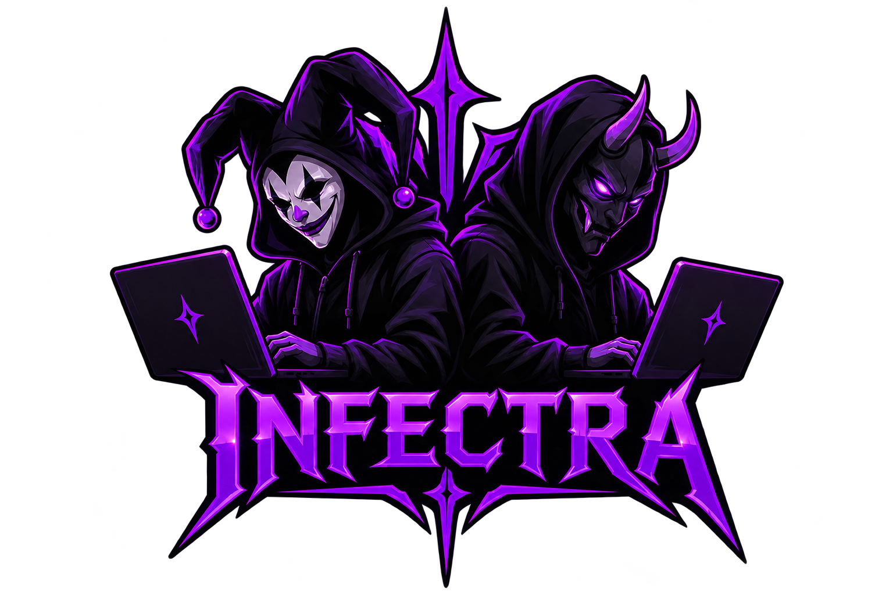

# INFECTRA PANEL

<p align="center">
  
</p>

<h3 align="center">A Dark Interface. A Powerful Identity.</h3>

<p align="center">
  A dark Pterodactyl panel theme with bold purple accents and a distinctive INFECTRA identity.
</p>

<p align="center">
  <strong>Dark UI · Purple Accent · Modern Design</strong>
</p>

---

## Overview

**INFECTRA** gives compatible Pterodactyl Panel installations a dark interface with purple accents and a distinct visual identity.

## Features

- Dark interface with black surfaces
- Purple INFECTRA accents
- Modern, consistent visual style
- Installation and recovery guidance

## Requirements

Before installing, make sure you have:

- A working Pterodactyl Panel installation and administrator/root access to its server
- The panel directory (commonly `/var/www/pterodactyl`)
- The INFECTRA release asset currently named `infectra-panel-redesign.tar.gz` (the downloaded file is actually a ZIP archive)
- A backup of your panel files and database

> **Archive format notice:** The GitHub release asset is named `infectra-panel-redesign.tar.gz`, but its contents are a ZIP archive. The commands below save it locally as `.zip` and use `unzip`. Always verify the ZIP contents match your installed Pterodactyl Panel version. Do not install an archive you have not checked.

## Complete Installation Guide

Run the commands on the server hosting your Pterodactyl **Panel**, not on a Wings node unless the panel is installed there too. Commands below assume Ubuntu and the standard panel directory `/var/www/pterodactyl`. Change the path if your installation uses a different location.

### 1. Open the panel directory

```bash
cd /var/www/pterodactyl
```

Confirm this is the correct directory:

```bash
test -f artisan && echo "Pterodactyl panel directory confirmed"
```

If `artisan` is not found, stop and locate your actual panel directory before continuing.

### 2. Back up the current panel files

Create a backup before replacing anything:

```bash
sudo tar -czf "/root/pterodactyl-files-backup-$(date +%F-%H%M).tar.gz" -C /var/www pterodactyl
```

Also back up your database using your own database name and credentials. For a MySQL/MariaDB installation, the general command is:

```bash
mysqldump -u YOUR_DATABASE_USER -p YOUR_DATABASE_NAME > ~/pterodactyl-database-backup.sql
```

Replace the placeholders with your actual values. Keep both backups somewhere safe.

### 3. Enable maintenance mode

```bash
cd /var/www/pterodactyl
php artisan down
```

### 4. Download the INFECTRA archive

```bash
curl -fL "https://github.com/rexxu958/INFECTRA-THEME/releases/latest/download/infectra-panel-redesign.tar.gz" -o /tmp/infectra-panel-redesign.zip
```

If the download fails, check that a published GitHub Release actually contains an asset named exactly `infectra-panel-redesign.tar.gz`.

### 5. Inspect the archive before installing

List the archive contents first:

```bash
unzip -t /tmp/infectra-panel-redesign.zip
unzip -l /tmp/infectra-panel-redesign.zip
```

Extract it into a temporary directory so you can check its layout:

```bash
mkdir -p /tmp/infectra-panel-redesign
unzip /tmp/infectra-panel-redesign.zip -d /tmp/infectra-panel-redesign
find /tmp/infectra-panel-redesign -maxdepth 3 -type f | head -80
```

Check the extracted files and any installation instructions included in the archive. **Do not copy files blindly** if the ZIP contains a nested project directory, unrelated files, or files intended for a different panel version.

### 6. Copy the theme files into the panel

Only if inspection confirms that the extracted archive's contents are arranged to merge directly into the root of your existing Pterodactyl installation, copy them with:

```bash
cp -a /tmp/infectra-panel-redesign/. /var/www/pterodactyl/
```

If the archive contains a nested directory or has its own installation script, follow the package's actual directory structure and instructions instead. Do not run an unfamiliar script without reviewing it first.

### 7. Set ownership and permissions

For a typical Ubuntu installation using Nginx and PHP-FPM, restore ownership of writable Laravel directories:

```bash
chown -R www-data:www-data /var/www/pterodactyl/storage /var/www/pterodactyl/bootstrap/cache
chmod -R 755 /var/www/pterodactyl/storage /var/www/pterodactyl/bootstrap/cache
```

Use the correct web-server account for your environment. If the panel requires different permissions, follow the official instructions for your installed version.

### 8. Clear the panel caches

```bash
cd /var/www/pterodactyl
php artisan view:clear
php artisan config:clear
php artisan cache:clear
```

Do not run database migrations, `composer install`, or asset-build commands automatically just for a theme. Run them only if the release's verified instructions explicitly require them and you have checked compatibility.

### 9. Bring the panel back online

```bash
php artisan up
php artisan queue:restart
```

If your environment uses a different queue or PHP-FPM service setup, restart only the relevant services according to your server configuration.

### 10. Verify the installation

1. Open your panel URL and sign in.
2. Check the dashboard, navigation, server pages, and mobile layout.
3. Check the browser developer console and server logs for errors.
4. Confirm that existing servers, users, and settings still work.

If the panel fails, enable maintenance mode if needed and restore the files/database from your backups. Do not delete the backups until the installation has been verified.

## Troubleshooting

- **404 or download failure:** Confirm the release is published and the asset name is exactly `infectra-panel-redesign.tar.gz`.
- **Archive extraction error:** Re-download the asset, then run `unzip -t /tmp/infectra-panel-redesign.zip` and `unzip -l /tmp/infectra-panel-redesign.zip`. Although the release asset name ends in `.tar.gz`, the current file is a ZIP archive; use `unzip`, not `tar -xzf`.
- **Blank page or server error:** Check `/var/www/pterodactyl/storage/logs/` and your web-server/PHP-FPM logs.
- **Permission errors:** Verify the panel path and web-server user; avoid applying broad permissions to the entire server.
- **Theme does not appear:** Confirm the correct files were copied into the panel root and clear the caches again.

## Compatibility

- **Platform:** Pterodactyl Panel
- **Theme:** INFECTRA
- **GitHub release asset name:** `infectra-panel-redesign.tar.gz` (actual archive format: ZIP)
- **Compatibility:** Depends on the archive contents and installed panel version

## License

Check the license terms of Pterodactyl and all bundled components before redistributing this package.

---

<p align="center">
  <strong>INFECTRA</strong><br>
  <em>Dark by design. Distinct by nature.</em>
</p>
